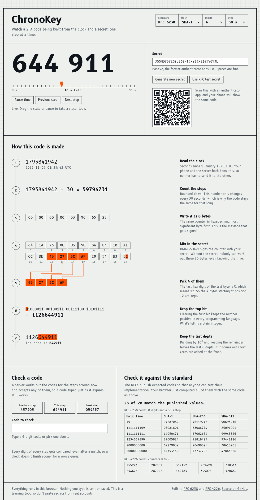

# ChronoKey

An interactive look inside two-factor codes. Watch a TOTP code being built from the clock and a secret, one step at a time, and scan the QR code to see your phone produce the same digits.

**Live:** [chronokey.shaikhaman.in](https://chronokey.shaikhaman.in)



**Stack:** TypeScript, React, Vite, Web Crypto. The core has no runtime dependencies and runs in the browser and in Node.

## What it shows

Every value updates live, and you can pause or scrub time to look closely.

1. **Read the clock:** seconds since 1970.
2. **Count the steps:** divide by 30 and round down.
3. **Write it as 8 bytes:** the counter, big-endian.
4. **Mix in the secret:** HMAC of the counter with the secret.
5. **Pick 4 bytes:** the last 4 bits of the HMAC choose where to read from.
6. **Drop the top bit:** this leaves a positive 31-bit integer.
7. **Keep the last digits:** the remainder after dividing by 10^6 is the code.

It also has a verify panel that shows the drift window of one step either side, and runs all 28 published RFC test values live in your browser.

## Privacy

Everything runs on the page. Nothing you type is sent or saved, there are no analytics, and the fonts are self-hosted. A Content-Security-Policy of `connect-src 'none'` makes the browser block any script from sending data with `fetch` or similar calls. It's still a learning tool, so don't paste secrets from real accounts.

## Run

Needs Node 24.

```bash
npm install
npm run dev        # the page, at http://localhost:5173
npm test           # 58 tests
npm run typecheck
npm run build      # static site in dist/
```

## Command line

```bash
npm run cli -- enroll you@example.com    # new secret and otpauth:// link
npm run cli -- code <secret>             # current code
npm run cli -- verify <secret> <code>    # check a code, allowing one step of drift
npm run cli -- hotp <secret> <counter>   # counter-based code
```

## Design decisions

- **One core for browser and Node.** It uses Web Crypto instead of Node's `crypto`, so the page and the command line run the same code and the same tests.
- **`hotpSteps()` returns every intermediate value.** The page displays what the algorithm actually computed instead of redoing the maths for show.
- **Tested against the standards.** All RFC 4226 and RFC 6238 test values are checked, including the RFC's intermediate values for counter 0. The tests and the page share one list in `src/vectors.ts`.
- **The whole window is always checked.** Verification compares every digit of every step, even after a match.

## Limitations

- **Not for production verification.** JavaScript engines can't guarantee constant-time execution, so a real server should use something like Node's `crypto.timingSafeEqual`, and should also rate-limit attempts and reject reused codes.
- **Custom settings may not work with authenticator apps.** Many of them ignore anything other than SHA-1, 6 digits and 30 seconds.

## License

[MIT](LICENSE)
